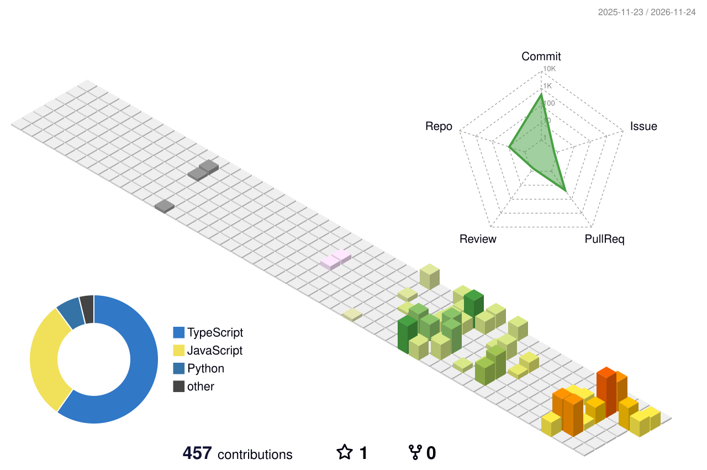

<picture>
  <source media="(prefers-color-scheme: dark)" srcset="./assets/banner-dark.svg">
  
</picture>

<p align="center">
  <a href="https://portafolio.buildrion.com">
    
  </a>
</p>

<p align="center">
  <a href="https://portafolio.buildrion.com"></a>
  <a href="https://www.linkedin.com/in/camilo-guapacha-a6732b270/"></a>
  <a href="mailto:juancamilog9911@gmail.com"></a>
  <a href="https://portafolio.buildrion.com/es/cv"></a>
</p>

<p align="center">
  
  
  
</p>

---

## 👋 Sobre mí

<table>
<tr>
<td width="55%" valign="top">

Soy **Camilo Guapacha**, desarrollador **Full Stack** en Pereira, Colombia. Construyo **sistemas web
completos**: desde la idea hasta que la gente los usa. Trabajo en lo que se ve (pantallas y
formularios), en lo que no se ve (la lógica y la base de datos) y lo dejo publicado y funcionando.

- 🎓 Estudio **Ingeniería de Sistemas y Computación** en la UTP (desde agosto de 2026)
- 💼 Trabajo como **desarrollador de software** en sistemas para el sector financiero y público
- 🛠️ Mantengo **[Tourwright](https://github.com/CXmiloxx/TOURWRIGHT)**, open source publicado en npm
- 🤖 Uso **IA con criterio**: asistentes para programar, herramientas MCP y revisión de todo
- 🌎 Español nativo · inglés técnico

</td>
<td width="45%" valign="top">

```ts
const camilo = {
  rol: "Desarrollador Full Stack",
  ubicacion: "Pereira, Colombia",
  estudio: "Ing. de Sistemas · UTP",
  frontend: ["Next.js", "React", "Tailwind"],
  backend: ["NestJS", "Express", "Prisma"],
  datos: ["MySQL", "Redis"],
  despliegue: ["Docker", "Linux", "Cloudflare"],
  arquitectura: "hexagonal",
  ia: ["Claude Code", "MCP"],
}
```

</td>
</tr>
</table>

## 🧭 Cómo trabajo: de la idea al sistema

| 1 · Entender | 2 · Diseñar | 3 · Construir | 4 · Publicar y mejorar |
|---|---|---|---|
| Converso con quienes van a usar el sistema y defino qué debe hacer. | Decido cómo se organiza: pantallas, datos y reglas del negocio. | Programo las pantallas, la lógica y la base de datos. | Lo pongo en línea, lo mantengo y lo ajusto con el uso real. |
| `requisitos` `flujos` | `arquitectura` `modelo de datos` | `Next.js` `NestJS` `MySQL` | `Docker` `Linux` `Cloudflare` |

## 🚀 Sistemas que he construido

> La mayoría vive en repositorios privados de clientes. Detalle y diagramas de arquitectura en el **[portafolio](https://portafolio.buildrion.com)**.

| Proyecto | Qué hace, en simple | Cómo está hecho | Estado |
|---|---|---|:---:|
| **Mi Cupo Ya** | Venta de celulares a crédito por WhatsApp y web: consulta a la persona, calcula el cupo, arma el plan y el crédito se aprueba solo. | 8 servicios NestJS · CONSULTAR · Payvalida · webhooks HMAC · Docker | ✅ Terminado |
| **Plataforma de créditos** | Créditos con aliados comerciales: perfila con CONSULTAR, revisa DataCrédito, aprueba, cobra y reporta la cartera a la central. | 13 servicios NestJS · Experian HDC+ · BullMQ · hexagonal | 🟢 En producción |
| **INSYTE** | Con los datos básicos de una persona, la busca en todas las entidades públicas que se pueden consultar para ayudar a localizarla, y entrega todo en una sola ficha. | NestJS · 39 fuentes · worker BullMQ + Redis · Next.js | 🟢 En producción |
| **Gestión Social** | Recursos humanos para varias empresas a la vez, cada una con su información aislada. | Multi-tenant · NestJS · Next.js | 🟢 En producción |
| **Procesos judiciales** | Revisa a diario la Rama Judicial y deja cada expediente al día con sus documentos. | Express · scrapers programados · Next.js | 🟢 En producción |

## 📦 Open source

<p align="center">
  <a href="https://github.com/CXmiloxx/TOURWRIGHT"></a>
  <a href="https://www.npmjs.com/package/tourwright"></a>
  <a href="https://www.npmjs.com/package/tourwright"></a>
  
  
</p>

<p align="center">
  <a href="https://github.com/CXmiloxx/TOURWRIGHT"><picture><source media="(prefers-color-scheme: dark)" srcset="https://github-readme-stats.vercel.app/api/pin/?username=CXmiloxx&repo=TOURWRIGHT&bg_color=0a0a0b&title_color=ff5a1f&icon_color=ff5a1f&text_color=edeae3&border_color=26262a&hide_border=false&border_radius=12&description_lines_count=2"></picture></a>
  <a href="https://github.com/CXmiloxx/gitmoji-commits"><picture><source media="(prefers-color-scheme: dark)" srcset="https://github-readme-stats.vercel.app/api/pin/?username=CXmiloxx&repo=gitmoji-commits&bg_color=0a0a0b&title_color=ff5a1f&icon_color=ff5a1f&text_color=edeae3&border_color=26262a&hide_border=false&border_radius=12&description_lines_count=2"></picture></a>
  <a href="https://github.com/CXmiloxx/portfolio"><picture><source media="(prefers-color-scheme: dark)" srcset="https://github-readme-stats.vercel.app/api/pin/?username=CXmiloxx&repo=portfolio&bg_color=0a0a0b&title_color=ff5a1f&icon_color=ff5a1f&text_color=edeae3&border_color=26262a&hide_border=false&border_radius=12&description_lines_count=2"></picture></a>
  <a href="https://github.com/CXmiloxx/DOCUMENTS-SYSTEM"><picture><source media="(prefers-color-scheme: dark)" srcset="https://github-readme-stats.vercel.app/api/pin/?username=CXmiloxx&repo=DOCUMENTS-SYSTEM&bg_color=0a0a0b&title_color=ff5a1f&icon_color=ff5a1f&text_color=edeae3&border_color=26262a&hide_border=false&border_radius=12&description_lines_count=2"></picture></a>
</p>

## 🧰 Tecnologías

| Área | Herramientas |
|---|---|
| **Frontend** |  |
| **Backend** |  |
| **Datos** |  |
| **Despliegue** |  |
| **Herramientas** |  |

## 📊 Estadísticas

<p align="center">
  <picture><source media="(prefers-color-scheme: dark)" srcset="https://github-readme-stats.vercel.app/api?username=CXmiloxx&show_icons=true&include_all_commits=true&count_private=true&rank_icon=percentile&bg_color=0a0a0b&title_color=ff5a1f&icon_color=ff5a1f&text_color=edeae3&border_color=26262a&hide_border=false&border_radius=12&locale=es"></picture>
  <picture><source media="(prefers-color-scheme: dark)" srcset="https://github-readme-stats.vercel.app/api/top-langs?username=CXmiloxx&layout=donut&langs_count=8&bg_color=0a0a0b&title_color=ff5a1f&icon_color=ff5a1f&text_color=edeae3&border_color=26262a&hide_border=false&border_radius=12&locale=es"></picture>
</p>

<p align="center">
  <picture><source media="(prefers-color-scheme: dark)" srcset="https://streak-stats.demolab.com?user=CXmiloxx&background=0A0A0B&ring=FF5A1F&fire=FF5A1F&currStreakNum=EDEAE3&sideNums=EDEAE3&currStreakLabel=FF5A1F&sideLabels=B4B0A7&dates=7D7A73&stroke=26262A&border=26262A&border_radius=12&locale=es"></picture>
</p>

<p align="center">
  <picture><source media="(prefers-color-scheme: dark)" srcset="https://github-profile-summary-cards.vercel.app/api/cards/profile-details?username=CXmiloxx&theme=github_dark"></picture>
</p>

<p align="center">
  <picture><source media="(prefers-color-scheme: dark)" srcset="https://github-profile-summary-cards.vercel.app/api/cards/repos-per-language?username=CXmiloxx&theme=github_dark"></picture>
  <picture><source media="(prefers-color-scheme: dark)" srcset="https://github-profile-summary-cards.vercel.app/api/cards/most-commit-language?username=CXmiloxx&theme=github_dark"></picture>
  <picture><source media="(prefers-color-scheme: dark)" srcset="https://github-profile-summary-cards.vercel.app/api/cards/productive-time?username=CXmiloxx&theme=github_dark&utcOffset=-5"></picture>
</p>

<picture><source media="(prefers-color-scheme: dark)" srcset="https://github-readme-activity-graph.vercel.app/graph?username=CXmiloxx&bg_color=0A0A0B&color=EDEAE3&line=FF5A1F&point=EDEAE3&area=true&area_color=FF5A1F&hide_border=true&radius=12&custom_title=Contribuciones%20en%20el%20%C3%BAltimo%20mes"></picture>

<details>
<summary><b>🧱 Mi año en 3D y la serpiente de contribuciones</b></summary>
<br>

<picture><source media="(prefers-color-scheme: dark)" srcset="./profile-3d-contrib/profile-night-view.svg"></picture>

<picture><source media="(prefers-color-scheme: dark)" srcset="./output/snake-dark.svg"></picture>

</details>

## 🛤️ Trayectoria

| Cuándo | Qué |
|---|---|
| **2026 — en curso** | 🎓 Ingeniería de Sistemas y Computación · Universidad Tecnológica de Pereira |
| **Oct 2025 — hoy** | 💼 Desarrollador de software · sistemas para el sector financiero y público |
| **Jun — Oct 2025** | 🧑‍💻 Desarrollador independiente · billetera empresarial y procesamiento de imágenes con IA |
| **Ene — Jul 2025** | 🏥 Prácticas SENA en World Travel Assist by HAS · citas y emergencias médicas, PWA multiempresa |
| **2023 — 2025** | 🎓 Tecnólogo en Análisis y Desarrollo de Software · SENA |

---

<p align="center">
  <sub>¿Quieres saber más de algún proyecto? Escríbeme a <a href="mailto:juancamilog9911@gmail.com">juancamilog9911@gmail.com</a> o mira el <a href="https://portafolio.buildrion.com">portafolio</a>.</sub>
</p>
